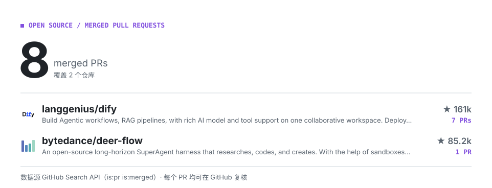

<picture>
  <source media="(prefers-color-scheme: dark)" srcset="./assets/hero-dark.svg">
  
</picture>

<!-- CONTRIB:BEGIN -->
<picture>
  <source media="(prefers-color-scheme: dark)" srcset="./assets/contrib-dark.svg">
  
</picture>
<!-- CONTRIB:END -->

## 开源贡献

在 [Dify](https://github.com/langgenius/dify) 的公开仓库中参与 API 测试，部分已合并 PR：

- [使用 SQLite 测试草稿变量批量清理](https://github.com/langgenius/dify/pull/45139)
- [使用 SQLite 测试运行时 skill 身份](https://github.com/langgenius/dify/pull/45140)
- [使用未绑定会话测试 DSL 节点校验](https://github.com/langgenius/dify/pull/45141)
- [测试 snippet repository 使用调用方会话](https://github.com/langgenius/dify/pull/45143)
- [测试未绑定会话下的分段归属拒绝](https://github.com/langgenius/dify/pull/45148)
